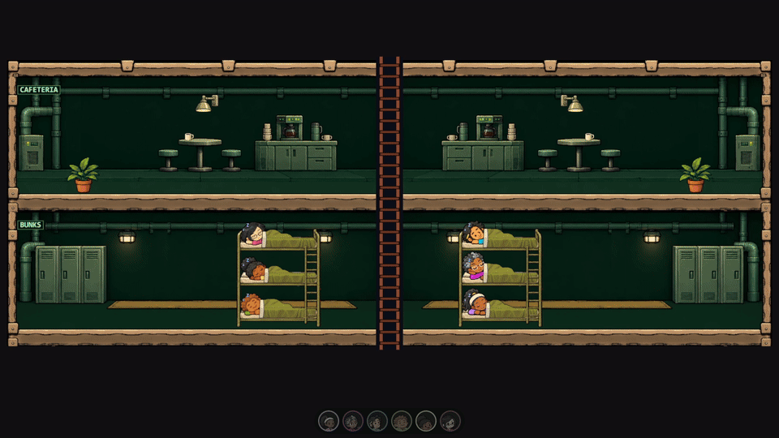
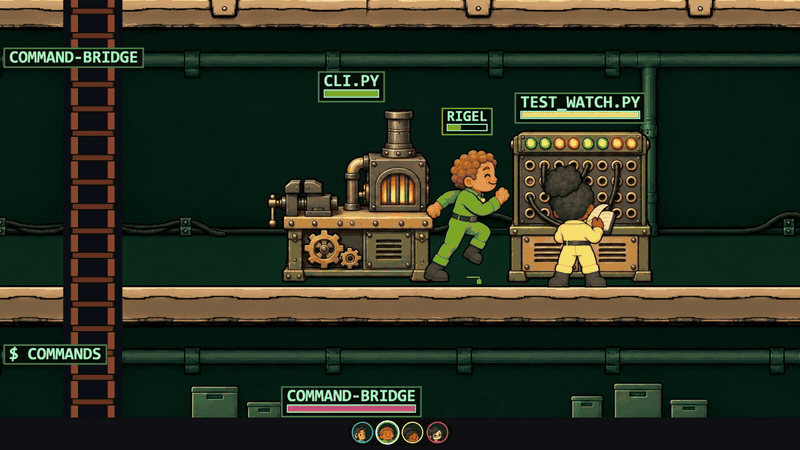

# Tokens Not Included

**Watch your Claude Code agents at work, as a colony.**

Tokens Not Included turns a fleet of coding agents into little workers in a building. Every agent is a character, and what it's doing right now is what you see it doing:

- **Each repository is a floor, and each file it touches is a station.** An agent editing a file walks to that file's station and works it.
- **Each command is a machine.** `git` is a record press, a test run is a fabricator bench, a web fetch is a radio set.
- **When one agent briefs another, they meet.** The two walk to each other and talk it through.
- **Idle agents go for coffee** in the cafeteria.
- **Each name plate shows that agent's context window** filling up in its own colour.

Live, every move comes from the agents' own session logs: an agent is only ever shown at a tool call it actually made. (The clips above are a recorded demo story.)

It runs on top of [Command Bridge](https://command-bridge.juanjofuchs.com), the local voice and canvas tool for talking to your agents.

## Coming soon

The code isn't public yet. Star or watch this repo to hear when it lands.
